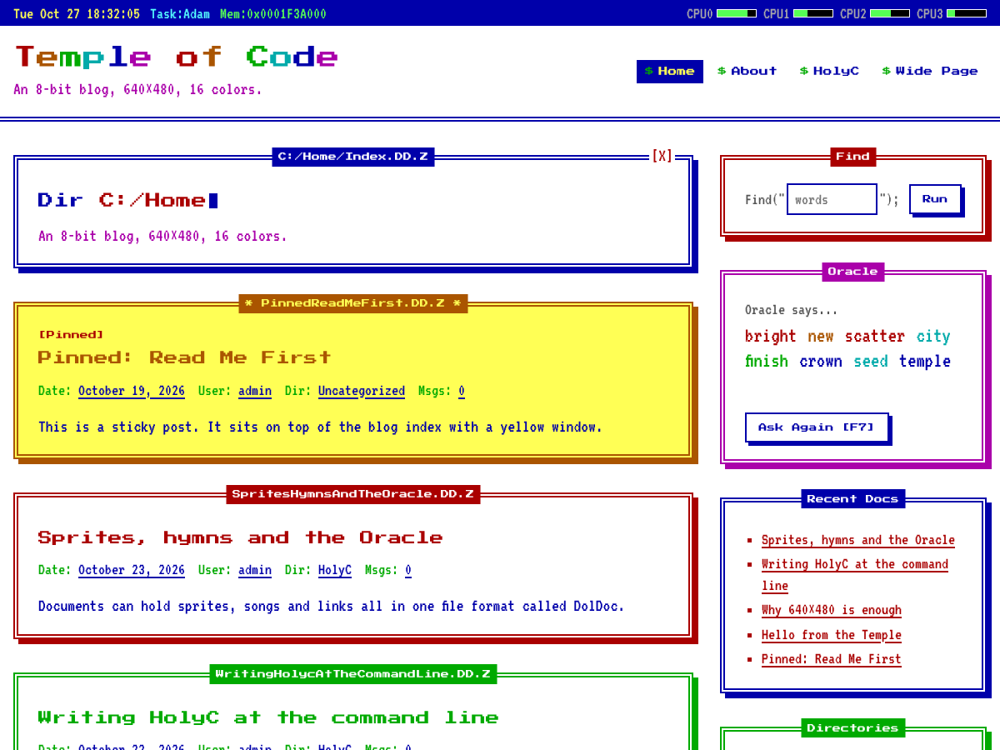

# Temple: a TempleOS-inspired WordPress theme

A classic PHP WordPress theme inspired by [TempleOS](https://templeos.org/), the operating system Terry A. Davis built by himself.



- **Classic Editor and Classic Widgets by default.** The block editor is turned off for posts, pages and widgets, and the block library CSS is removed from the front end. You don't need a plugin for this.
- **16-color VGA palette**: blue text on a white screen, the same 16 colors TempleOS uses.
- **Pixel fonts**: VT323 for body text and Press Start 2P for titles and chrome. Both are bundled with the theme, so nothing loads from a font CDN.
- **DolDoc windows**: double-line borders with the title in the top edge and a `[X]` close button. In lists, each post is its own window, and the border color cycles through the palette.
- **Status bar** with a live clock, the current "task", a memory counter and CPU meters.
- **Fake file paths** in window titles, e.g. `C:/Home/Blog/HelloWorld.DD.Z`.
- **Rainbow site title**, blinking cursor and pixel mouse pointer.
- **Oracle widget**: draws random words, like TempleOS's oracle. Press the button or `F7` to draw again.
- **404 page** looks like a TempleOS crash screen.

## Install

Copy this repository into `wp-content/themes/temple` (or zip it and upload it under *Appearance > Themes > Add New*), then activate **Temple**.

Requires WordPress 6.0+ and PHP 7.4+.

## Templates

| File | Used for |
| --- | --- |
| `index.php` | Blog index and the fallback for every view |
| `single.php` | Single post, with post navigation and comments |
| `page.php` | Single page |
| `archive.php` | Category, tag, author, date and taxonomy archives |
| `search.php` | Search results |
| `404.php` | Not found (the crash screen) |
| `templates/full-width.php` | Page template **Full Width (No Sidebar)**, for pages and posts |
| `header.php` / `footer.php` / `sidebar.php` | Status bar, menu bar, footer, sidebar windows |
| `comments.php` / `searchform.php` | Comment window; the `Find("...");` search prompt |
| `template-parts/content*.php` | Post windows for lists, single posts, pages, search results and empty results |

## Theme code

| File | What it does |
| --- | --- |
| `inc/classic-editor.php` | Turns the block editor off and removes block CSS |
| `inc/setup.php` | Theme supports, menus, body classes, excerpt settings |
| `inc/enqueue.php` | Styles, scripts and the font preload |
| `inc/template-tags.php` | Rainbow text, file paths, status bar, post meta, pagination |
| `inc/widgets.php` | Widget areas and the Oracle widget |
| `inc/customizer.php` | The *TempleOS* section in the Customizer |
| `assets/css/main.css` | All front-end styles |
| `assets/css/editor-style.css` | Classic Editor (TinyMCE) styles |
| `assets/js/templeos.js` | Clock, CPU meters, Oracle and mobile menu. Has no dependencies |

## Options

**Appearance > Customize > TempleOS** has toggles for the status bar, the rainbow title, blinking text and the pixel mouse pointer, plus a box for custom footer text. Blinking and animation also stop when the visitor's system asks for reduced motion.

Menus: **Menu Bar (top)** and **Footer Menu**. Widget areas: **Sidebar** and **Footer**. If the sidebar is empty, it shows Find, Oracle, Recent Docs and Directories windows.

## Filters

```php
// Turn the block editor back on, for posts or widgets.
add_filter( 'temple_use_classic_editor', '__return_false' );
add_filter( 'temple_use_classic_widgets', '__return_false' );

// Keep the core block CSS on the front end.
add_filter( 'temple_remove_block_styles', '__return_false' );

// Your own Oracle vocabulary.
add_filter( 'temple_oracle_words', function ( $words ) {
	return array( 'alpha', 'beta', 'gamma' );
} );

// Other hooks: temple_content_width, temple_has_sidebar,
// temple_doc_path, temple_status_bar_cores.
```

## Credits

- TempleOS by Terry A. Davis (1969-2018). TempleOS is in the public domain. This theme isn't affiliated with it.
- [VT323](https://fonts.google.com/specimen/VT323) by Peter Hull, and [Press Start 2P](https://fonts.google.com/specimen/Press+Start+2P) by CodeMan38. Both are under the SIL Open Font License 1.1; see `assets/fonts/*/OFL.txt`.

## License

GNU General Public License v2 or later.
